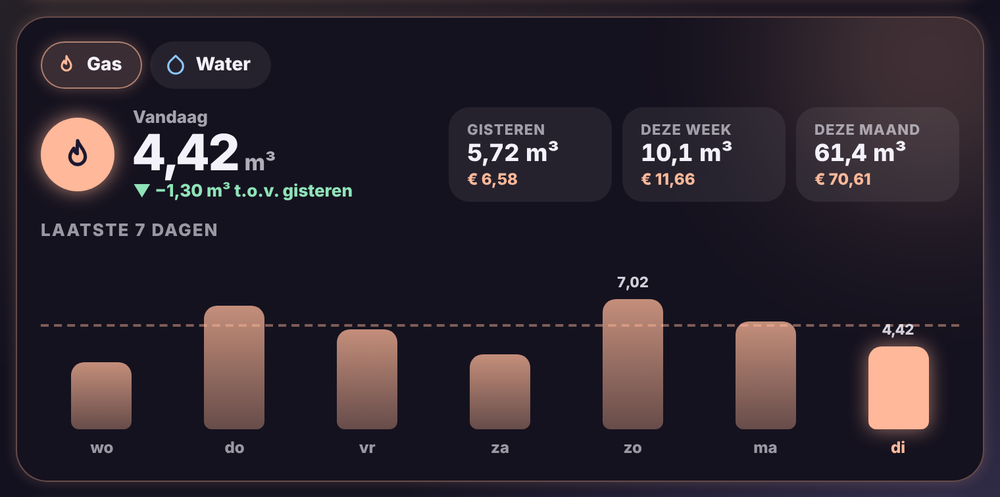

# Glow Usage Card

🇬🇧 [English](usage.md) · 🇳🇱 Nederlands



Het verbruik van gas en water (of eender welke meter) in één kaart.

- **Vandaag** groot, met een pijltje hoeveel meer of minder dan gisteren: groen als je minder verbruikt, perzik als het meer is.
- **Gisteren, deze week en deze maand** in drie vakjes, met de kosten als je een prijs opgeeft.
- **Staafjes** voor de laatste 7 dagen (instelbaar tot 31), met een stippellijn voor het gemiddelde en de dag van vandaag gloeiend.
- **Meerdere meters**: bovenaan wissel je met knopjes tussen bv. gas en water. Gas kleurt perzik, water blauw.

De cijfers komen uit de langetermijnstatistieken van Home Assistant, dezelfde als in het energiedashboard. Gebruik daarom de **totale meterstand** (een sensor met `state_class: total_increasing`, bv. van je digitale meter of P1-lezer).

```yaml
type: custom:glow-usage-card
meters:
  - sensor.gas_verbruik
  - sensor.water_verbruik
gas_price: 1.15
water_price: 5.2
```

| Optie | Standaard | Uitleg |
|---|---|---|
| `meters` | – | Lijst met meters. Ook `{ entity: sensor.water, name: Water, color: '#8EC5FF', price: 5.2 }` kan. |
| `name` | – | Titel boven de kaart. |
| `gas_price` | – | Prijs per eenheid gas (bv. per m³). |
| `water_price` | – | Prijs per eenheid water. |
| `days` | `7` | Aantal dagen in de grafiek (3 tot 31). |
| `glow` | `15` | Sterkte van de gloed. |
| `language` | automatisch | `nl`, `en`, `fr`, `de`, `es` of `it`. |
