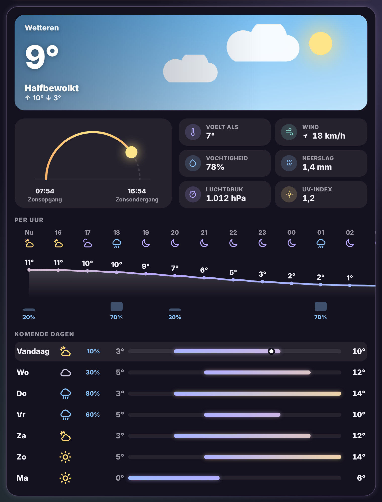

# Glow Weather Card

🇬🇧 English · 🇳🇱 [Nederlands](weather.nl.md)



The weather with every detail, in the Glow style. Meant for its own view, but it also fits narrower spots.

- **Sky**: a sky that follows the weather and the time of day, with sun, moon, stars, clouds, rain, snow, fog or lightning. On top: the temperature, the condition and today's high and low.
- **Sun arc**: an arc from sunrise to sunset with the sun where it is now.
- **Details**: feels like, wind (with an arrow for the direction), humidity, precipitation, pressure, UV index and cloud cover, as far as your weather service provides them.
- **Hourly**: a temperature curve that changes colour (cold blue, mild yellow, warm peach), with icons and bars for the chance of rain. Scroll sideways through it.
- **Next days**: per day a bar from low to high temperature, on one shared scale so you can see which days are warmer. Today has a dot for the current temperature.

The forecast is fetched the way Home Assistant does it today (subscription), so it works with any weather integration.

```yaml
type: custom:glow-weather-card
entity: weather.forecast_thuis
```

| Option | Default | Description |
|---|---|---|
| `entity` | – | The weather entity. |
| `name` | entity name | Name in the sky. |
| `show_details` | `true` | Sun arc and details. |
| `show_hourly` | `true` | Hourly forecast. |
| `show_daily` | `true` | Daily forecast. |
| `days` | `7` | Number of days. |
| `glow` | `15` | Glow strength. |
| `language` | automatic | `en`, `nl`, `fr`, `de`, `es` or `it`. |
