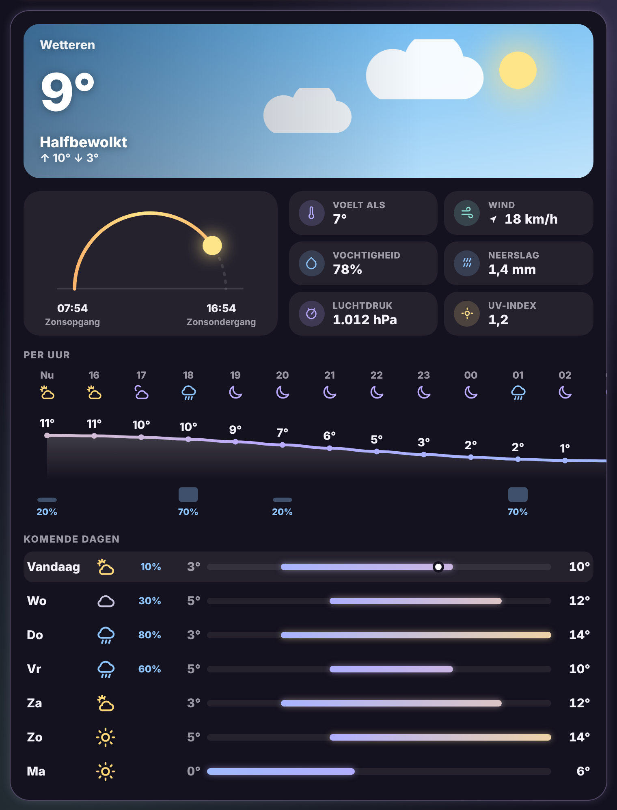

# Glow Weather Card

🇬🇧 [English](weather.md) · 🇳🇱 Nederlands



Het weer met alle details, in de Glow-stijl. Bedoeld voor een eigen view, maar ze past ook smaller.

- **Lucht**: een lucht die het weer en het dagdeel volgt, met zon, maan, sterren, wolken, regen, sneeuw, mist of bliksem. Daarop de temperatuur, het weer en de hoogste en laagste temperatuur van vandaag.
- **Zonneboog**: een boog van zonsopgang tot zonsondergang met de zon op de plaats waar ze nu staat.
- **Details**: gevoelstemperatuur, wind (met een pijltje voor de richting), vochtigheid, neerslag, luchtdruk, UV-index en bewolking, voor zover je weerdienst ze geeft.
- **Per uur**: een temperatuurcurve die van kleur verloopt (koud blauw, mild geel, warm perzik), met icoontjes en staafjes voor de regenkans. Je kunt er horizontaal door scrollen.
- **Komende dagen**: per dag een balk van de laagste tot de hoogste temperatuur, op één gemeenschappelijke schaal zodat je ziet welke dagen warmer zijn. Op vandaag staat een bolletje voor de huidige temperatuur.

De verwachting wordt opgehaald zoals Home Assistant dat vandaag doet (`weather.get_forecasts`/abonnement), dus het werkt met elke weerintegratie.

```yaml
type: custom:glow-weather-card
entity: weather.forecast_thuis
```

| Optie | Standaard | Uitleg |
|---|---|---|
| `entity` | – | De weer-entiteit. |
| `name` | naam van de entiteit | Naam in de lucht. |
| `show_details` | `true` | Zonneboog en details. |
| `show_hourly` | `true` | Verwachting per uur. |
| `show_daily` | `true` | Verwachting per dag. |
| `days` | `7` | Aantal dagen. |
| `glow` | `15` | Sterkte van de gloed. |
| `language` | automatisch | `nl`, `en`, `fr`, `de`, `es` of `it`. |
