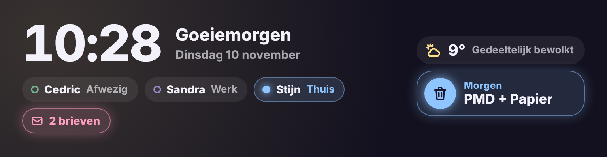

# Glow Welcome Card

🇬🇧 English · 🇳🇱 [Nederlands](welcome.nl.md)



A welcome card for the top of the dashboard, without a background. It spans the full width but stays low.

- **Time, date and greeting**: Good morning, Good afternoon, Good evening or Good night, optionally with a name.
- **People**: every `person.` entity with their full name and where they are (Home, Work, Away, …), in the colour of that zone.
- **Weather**: icon, temperature and condition of your weather entity.
- **Waste**: the next collection from the [Afvalbeheer](https://github.com/pippyn/Home-Assistant-Sensor-Afvalbeheer) integration. The card finds the sensors itself. It glows the day before ("Tomorrow", after noon "Put out tonight") and on collection day ("Today"). Two types on the same day are shown together, e.g. "PMD + Paper".
- **Mail**: when the mail counter is above 0, a pink label shows the number of letters. Tap it for a popup with the count, the time of the last delivery and a **Reset to 0** button.

Tap a person, the weather or the waste for the standard details.

```yaml
type: custom:glow-welcome-card
weather: weather.forecast_home
mail: counter.mailbox
```

| Option | Default | Description |
|---|---|---|
| `name` | – | Name after the greeting ("Good morning, Stijn"). |
| `persons` | everyone | Your own list of `person.` entities. |
| `weather` | first weather entity | Weather entity. |
| `waste` | automatic | Your own list of waste sensors (sensors with `days_until` or `sort_date`). |
| `mail` | – | Mail counter: a `counter`, `input_number` or `sensor`. |
| `mail_reset` | – | Only needed when `mail` is not a `counter` or `input_number`: a button, script or automation that sets the counter to 0. |
| `zone_colors` | see below | Colour per zone, e.g. `{ home: '#8FE3B8', Work: '#8EC5FF' }`. |
| `waste_colors` | see below | Colour per waste type, e.g. `{ PMD: '#8EC5FF', Residual: '#C9C4DD' }`. |
| `glow` | `15` | Glow strength in pixels. |
| `language` | automatic | `en`, `nl`, `fr`, `de`, `es` or `it`. |

## Colours

**People** take the colour of the zone they are in. Whoever is home gets a coloured label with a glowing dot. Whoever is in another zone gets a coloured dot. Whoever is in no zone (away) gets a grey ring. By default:

- home green, away grey;
- work/office blue, school yellow, sports peach, grandparents/family pink;
- other zones take turns in lavender, turquoise, peach and yellow.

**Waste** takes the colour of its type: PMD blue, organic and garden waste green, paper yellow, glass turquoise, residual waste grey.

Change both in the visual editor, under **Colours per zone** and **Colours per waste type**: every zone and every waste type found is listed with a colour picker. In YAML use `zone_colors` and `waste_colors`. The key is the zone name (`home` and `not_home` for home and away) or the waste type as shown on the card.

In a narrow spot (less than 560 px wide) the weather and waste move below the people.
