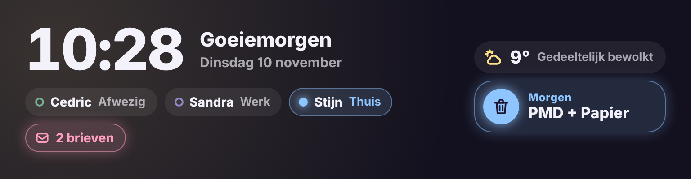

# Glow Welcome Card

🇬🇧 [English](welcome.md) · 🇳🇱 Nederlands



Een welkomstkaart voor bovenaan het dashboard, zonder achtergrond. Ze neemt de volle breedte maar blijft laag.

- **Uur, datum en begroeting**: Goeiemorgen, Goeiemiddag, Goeieavond of Goeienacht, eventueel met een naam erbij.
- **Personen**: alle `person.`-entiteiten met hun volledige naam en waar ze zijn (Thuis, Werk, Afwezig, …), in de kleur van die zone.
- **Weer**: icoon, temperatuur en omschrijving van je weer-entiteit.
- **Afval**: het eerstvolgende afval uit de integratie [Afvalbeheer](https://github.com/pippyn/Home-Assistant-Sensor-Afvalbeheer). De kaart vindt de sensoren zelf. Ze gloeit op de dag ervoor ("Morgen", na de middag "Vanavond buiten") en op de ophaaldag ("Vandaag"). Twee soorten op dezelfde dag staan samen, bv. "PMD + Papier".
- **Post**: is de postteller groter dan 0, dan verschijnt een roze label met het aantal brieven. Tik erop voor een popup met het aantal, het tijdstip van de laatste post en een knop **Op 0 zetten**.

Tik op een persoon, het weer of het afval voor de gewone details.

```yaml
type: custom:glow-welcome-card
weather: weather.forecast_thuis
mail: counter.post_in_de_brievenbus
```

| Optie | Standaard | Uitleg |
|---|---|---|
| `name` | – | Naam achter de begroeting ("Goeiemorgen, Stijn"). |
| `persons` | alle personen | Eigen lijst met `person.`-entiteiten. |
| `weather` | eerste weer-entiteit | Weer-entiteit. |
| `waste` | automatisch | Eigen lijst met afvalsensoren (sensoren met `days_until` of `sort_date`). |
| `mail` | – | Postteller: een `counter`, `input_number` of `sensor`. |
| `mail_reset` | – | Alleen nodig als `mail` geen `counter` of `input_number` is: een knop, script of automatisering die de teller op 0 zet. |
| `zone_colors` | zie onder | Kleur per zone, bv. `{ home: '#8FE3B8', Werk: '#8EC5FF' }`. |
| `waste_colors` | zie onder | Kleur per afvalsoort, bv. `{ PMD: '#8EC5FF', Restafval: '#C9C4DD' }`. |
| `glow` | `15` | Sterkte van de gloed in pixels. |
| `language` | automatisch | `nl`, `en`, `fr`, `de`, `es` of `it`. |

## Kleuren

**Personen** krijgen de kleur van de zone waar ze zijn. Wie thuis is, krijgt een gekleurd label met een gloeiend bolletje. Wie in een andere zone is, krijgt een gekleurd bolletje. Wie nergens is (afwezig), krijgt een grijs randje. Standaard:

- thuis groen, afwezig grijs;
- werk/kantoor blauw, school geel, sport perzik, oma/opa/familie roze;
- andere zones om beurten lavendel, turkoois, perzik en geel.

**Afval** krijgt de kleur van de soort: PMD blauw, GFT en groen afval groen, papier geel, glas turkoois, restafval grijs.

Beide pas je aan in de visuele editor, onder **Kleuren per zone** en **Kleuren per afvalsoort**: daar staat elke zone en elke gevonden afvalsoort met een kleurkiezer. In YAML gebruik je `zone_colors` en `waste_colors`. Als sleutel gebruik je de naam van de zone (`home` en `not_home` voor thuis en afwezig) of van de afvalsoort zoals ze op de kaart staat.

Op een smalle plek (minder dan 560 px breed) schuiven het weer en het afval onder de personen.
